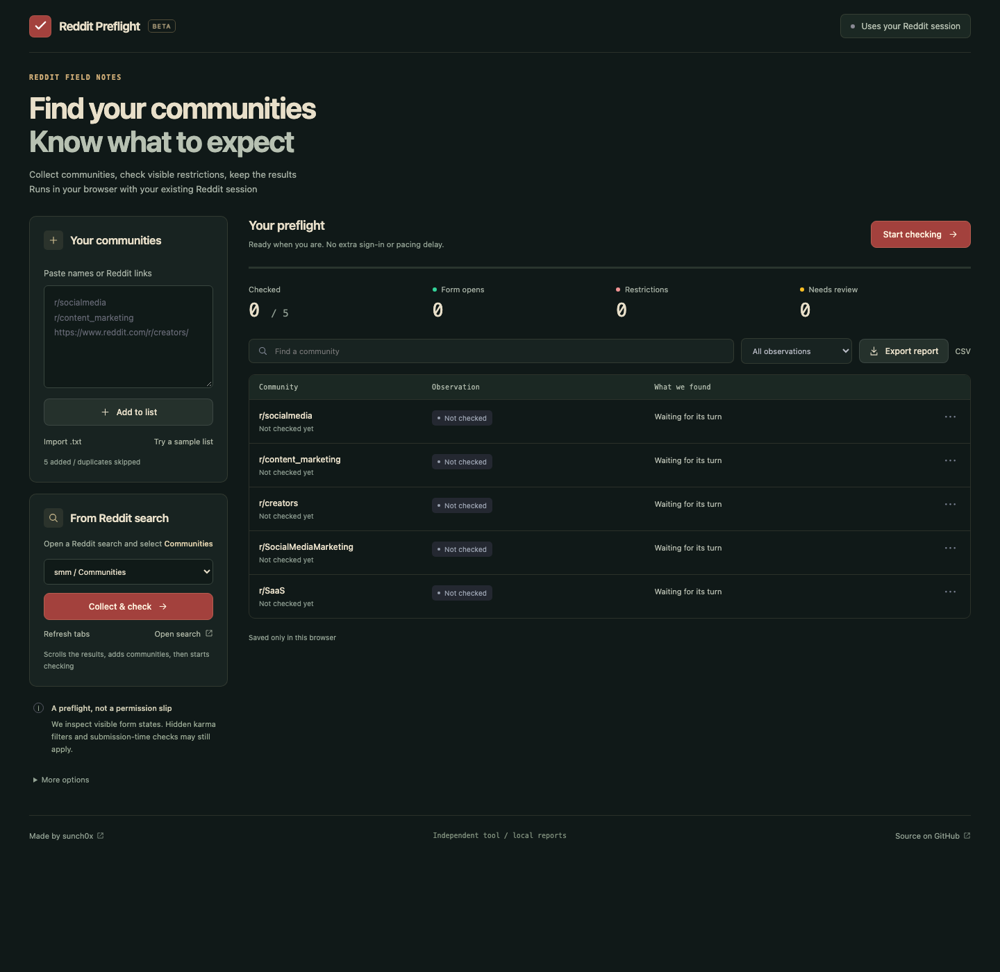

# Reddit Preflight

**Check the community before you write the post.**

A small, local Chrome extension that visits your community list in one reusable tab and records visible posting restrictions using your existing Reddit session.



Dashboard with an example community list, before a scan. No sample eligibility results are prefilled.

An independent tool by [sunch0x](https://linkdeck.co/sunch0x).

## What it does

- Paste subreddit names or links, or import a plain-text list
- **Collect & check**: scroll an open Reddit Communities search, collect names, then start checking
- Inspect visible account-age / karma gates, approval requests, sign-in prompts and browser challenges
- Reuse one checker-owned tab; no additional delay between completed checks
- Pause, resume, retry uncertain results and make your own manual marks
- Export an HTML report, CSV or a restorable JSON backup
- Recognize the current account when Reddit exposes an explicit account-menu identifier

**It does not post, fill in content, join, vote or send messages.** No server, extra account, API key or AI subscription is needed.

## Install in Chrome

This is an unpacked developer extension, not a Chrome Web Store listing.

1. Download the ZIP from [Releases](https://github.com/sunch0x/reddit-preflight/releases) and extract it, or clone this repository
2. Open `chrome://extensions` in the same Chrome profile you use for Reddit
3. Enable **Developer mode**
4. Click **Load unpacked** and select the extracted release folder, or the repository's **extension** folder
5. Click **Reddit Preflight** in Chrome's extensions menu

Sign in to Reddit normally before starting. You do not enter your username or password in Preflight.

## Collect & check

1. Open a Reddit search and select the **Communities** results tab
2. Click the extension icon while on that page, or select its tab under **From Reddit search**
3. Click **Collect & check**

Preflight reads community links from the results pane, scrolls it, deduplicates names and saves each batch locally. Once the loaded results stop growing at the bottom, it automatically checks pending communities. Existing observations are preserved, so already checked communities are not rechecked.

The search tab stays open. The form checker uses its own reusable tab. Stop the operation with **Pause**; collected names remain in your list and the checks do not start after a manual stop. If search navigation changes, a challenge appears or collection stalls, it stops and keeps the partial list for review.

This collects what Reddit loads for that specific search, not every subreddit on Reddit. Limits: 1,000 communities per list, a two-minute collection window, and a stop when the loaded results remain unchanged. After a partial collection, you can continue collecting from the same search or start checks yourself.

## Use it

Paste a list such as:

```text
r/socialmedia
r/content_marketing
https://www.reddit.com/r/creators/
```

Click **Add to list**, then **Start checking**. Keep the dashboard open. Checks are sequential; page loading and form rendering still take time. Closing the dashboard stops active work, and saved progress can be resumed.

If Reddit requests sign-in, rate-limits the session or shows a browser challenge, Preflight pauses. It does not bypass these checks. After resolving them yourself, use **Retry uncertain results**. If the detected Reddit account changed, use **Recheck all / changed Reddit account** instead.

At completion, export a report. Downloaded reports include every row, including pending or uncertain ones. Only the checker-owned tab is closed; a tab you navigated elsewhere is left alone.

## Understand the results

| Observation | Meaning |
|---|---|
| Form opens | An editable title and body appeared on two consecutive observations. **This is not permission to publish.** |
| Account requirement | A visible account-activity gate was detected; age and karma are distinguished when the message states them |
| Approval required | Reddit displayed a private-community or posting-approval requirement |
| Community unavailable | Reddit displayed an unavailable-community message |
| Needs review | The page could not be interpreted conclusively within the observation window |
| Sign in / browser check / rate limited | The scan paused so you can inspect the current tab |
| Account changed | Two different explicitly identified accounts were observed; the scan paused |
| Manually confirmed / excluded | Your own mark, distinct from the automated observation |

## Important limitations

Reddit can render a composer before checking eligibility, and some restrictions appear only after a submission attempt. AutoModerator and moderators may apply hidden rules or remove content later. An open composer does not prove that your account meets every requirement, and this tool never submits a test post to find out.

This is **not** a hidden-karma-threshold detector, a shadowban checker, a moderation-policy checker or a guarantee that promotional posts are allowed. It reports visible UI observations only. Late dialogs, UI changes, unsupported locales, closed shadow roots or slow pages can produce missed or uncertain results. English and common Russian blocking phrases are currently recognized; the interface and exports are English.

Account detection is opportunistic. It does not guess your identity from post authors or arbitrary profile links. If no explicit account-menu identifier is available, the account stays unidentified. Never combine checks from different Reddit accounts; recheck after switching.

Automated tests cover classification, delayed visible gates, queue behavior, local exports and ownership of the reusable tab. They do not establish compatibility with every live Reddit layout or account. Reports are observations tied to a time and account, not permanent eligibility records.

## Local development

Node.js 20.11+ and the system `zip` command are sufficient. No npm dependencies are installed.

```sh
npm test
npm run check
npm run package
```

Load `extension/` unpacked in Chrome. After changing extension files, click its reload button on `chrome://extensions`, then reopen the dashboard.

The extension starts with an empty list. The optional sample list contains only public community names with no prefilled results. Personal reports and browser state are not included in the repository or release package.

## Privacy and license

See [PRIVACY.md](PRIVACY.md). Runtime code and assets are local; no results are uploaded. Creator and product links are regular links, not trackers.

MIT licensed. This independent project is not affiliated with or endorsed by Reddit.
